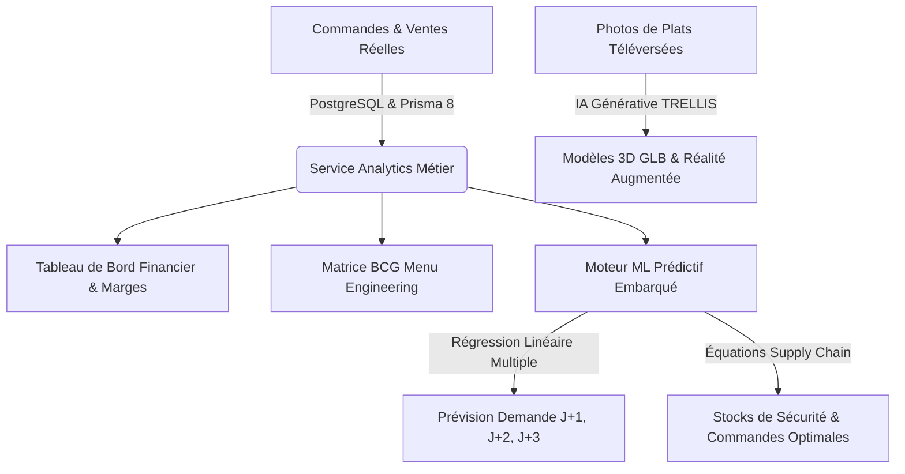
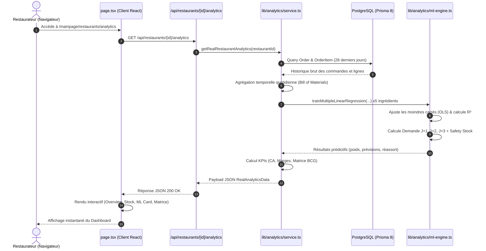

# 📘 Documentation Technique Restivo : Architecture, Analytics & Moteurs ML / IA

> **Projet :** Restivo  
> **Type d'application :** SaaS de Gestion de Restaurant, Menu Digital Interactif, AR 3D & Analytics Prédictif  
> **Stack Technique :** Next.js 16 (App Router), React 19, TypeScript, PostgreSQL, Prisma 8 (`@prisma/orm-postgres`), Tailwind CSS v4, `ml-regression`, `simple-statistics`, TRELLIS ZeroGPU  
> **Fichier généré :** `ANALYTICS_AND_ML_ARCHITECTURE.md`

---

## 📑 Sommaire

1. [Vue d'Ensemble & Vision du Système](#1-vue-densemble--vision-du-système)
2. [Structure Complète du Codebase (Code Structure)](#2-structure-complète-du-codebase-code-structure)
3. [Architecture du Module Analytics & Gestion Opérationnelle](#3-architecture-du-module-analytics--gestion-opérationnelle)
   - [3.1 Vue d'Ensemble & KPIs Financiers (OverviewTab)](#31-vue-densemble--kpis-financiers-overviewtab)
   - [3.2 Gestion de Stock & Fiches Recettes (StockManagementTab)](#32-gestion-de-stock--fiches-recettes-stockmanagementtab)
   - [3.3 Comptabilité, Dépenses & Caisse (AccountingRevenueTab)](#33-comptabilité-dépenses--caisse-accountingrevenuetab)
   - [3.4 Matrice de Menu Engineering BCG (MenuEngineeringTab)](#34-matrice-de-menu-engineering-bcg-menuengineeringtab)
4. [Moteur de Machine Learning Embarqué (Demand Forecasting)](#4-moteur-de-machine-learning-embarqué-demand-forecasting)
   - [4.1 Pourquoi un modèle ML local (Zero Cloud Cost) ?](#41-pourquoi-un-modèle-ml-local-zero-cloud-cost-)
   - [4.2 Formulation Mathématique : Régression Linéaire Multiple](#42-formulation-mathématique--régression-linéaire-multiple)
   - [4.3 Feature Engineering & Données Temporelles](#43-feature-engineering--données-temporelles)
   - [4.4 Évaluation du Modèle ($R^2$ et Erreur Standard)](#44-évaluation-du-modèle-r2-et-erreur-standard)
   - [4.5 Optimisation Supply Chain : Stock de Sécurité & Réassort](#45-optimisation-supply-chain--stock-de-sécurité--réassort)
   - [4.6 Pipeline de Données : Base PostgreSQL ➔ Ingrédients ➔ Entraînement](#46-pipeline-de-données--base-postgresql--ingrédients--entraînement)
   - [4.7 Composant UI ML (`MLPredictorCard.tsx`)](#47-composant-ui-ml-mlpredictorcardtsx)
5. [Moteur d'IA Générative 3D (Image-to-3D avec TRELLIS)](#5-moteur-dia-générative-3d-image-to-3d-avec-trellis)
6. [Schéma de Données & Modèles Prisma 8](#6-schéma-de-données--modèles-prisma-8)
7. [Flux de Données de Bout en Bout (End-to-End Data Flow)](#7-flux-de-données-de-bout-en-bout-end-to-end-data-flow)
8. [Guide d'Extension & Roadmap ML Future](#8-guide-dextension--roadmap-ml-future)

---

## 1. Vue d'Ensemble & Vision du Système

Le module **Analytics & Intelligence Artificielle** de **Restivo** a été conçu pour transformer un restaurant traditionnel en un établissement piloté par la donnée (*Data-Driven Restaurant*). 

Contrairement aux outils SaaS classiques qui se limitent à afficher des totaux statiques de ventes, Restivo combine trois piliers technologiques :



### Les Objectifs Clés :
1. **Éliminer le Gaspillage Alimentaire (*Food Waste*) :** Prédire précisément les quantités d'ingrédients bruts (viandes, pains, sauces, fromages) consommées selon les cycles hebdomadaires et les rushs de week-end.
2. **Éviter les Ruptures de Stock aux Heures de Pointe :** Calculer dynamiquement le stock de sécurité avec un niveau de service statistique à 95% ($Z = 1.65$).
3. **Optimiser la Rentabilité de la Carte :** Détecter automatiquement les plats "Étoiles" (stars) à forte marge et ceux nécessitant une réingénierie (dogs/plowhorses).
4. **Zéro Coût d'Infrastructure ML Externe :** L'entraînement et l'inférence de régression tournent directement sur le runtime Node.js/TypeScript via `ml-regression` et `simple-statistics`, sans serveurs Python ou APIs payantes.

---

## 2. Structure Complète du Codebase (Code Structure)

Voici l'architecture du projet mettant en évidence l'isolation claire entre l'interface utilisateur, la logique métier (*services*), la base de données (*Prisma 8*) et les moteurs d'IA :

```text
restivo-V1-main/
├── app/                                     # Next.js 16 App Router
│   ├── api/                                 # Routes API Backend
│   │   ├── auth/                            # Authentification JWT & sessions
│   │   ├── generate-3d/                     # Pipeline IA Image-to-3D
│   │   │   ├── fallback.ts                  # Modèles GLB de secours contextuels
│   │   │   ├── image-parser.ts              # Normalisation des flux d'images (Blob)
│   │   │   ├── normals.ts                   # Calcul des normales de vertex pour WebXR
│   │   │   ├── route.ts                     # Orchestrateur API de génération 3D
│   │   │   └── trellis.ts                   # Client REST / SSE pour Hugging Face TRELLIS
│   │   ├── restaurants/
│   │   │   └── [restaurantId]/
│   │   │       ├── analytics/               # Route API Analytics & ML
│   │   │       │   └── route.ts             # GET /api/restaurants/[id]/analytics
│   │   │       ├── floors/                  # Gestion des salles et plans de tables
│   │   │       ├── menu/                    # API de CRUD du Menu
│   │   │       └── staff/                   # API de gestion du personnel
│   │   └── upload-image/                    # Téléversement permanent d'images (disque)
│   │
│   ├── mainpage/                            # Interface d'Administration Principale
│   │   └── restaurants/
│   │       ├── _context/
│   │       │   └── RestaurantManagerContext.tsx # Contexte React : restaurant actif
│   │       ├── analytics/                   # Page Principale Analytics & ML
│   │       │   ├── _components/             # Composants React de présentation
│   │       │   │   ├── AccountingRevenueTab.tsx  # Clôture caisse & charges
│   │       │   │   ├── AddExpenseModal.tsx       # Modal d'ajout de dépense
│   │       │   │   ├── AddStockModal.tsx         # Modal d'entrée d'ingrédient
│   │       │   │   ├── AnalyticsHeader.tsx       # Titre, filtre période & exports
│   │       │   │   ├── AnalyticsTabs.tsx         # Barre de navigation à 5 onglets
│   │       │   │   ├── MLPredictorCard.tsx       # Carte IA, équations & réassort
│   │       │   │   ├── MenuEngineeringTab.tsx    # Matrice BCG Rentabilité vs Popularité
│   │       │   │   ├── OverviewTab.tsx           # Dashboard exécutif & KPIs globaux
│   │       │   │   └── StockManagementTab.tsx    # Inventaire, fiches recettes & pertes
│   │       │   ├── _lib/                    # Typages et données par défaut
│   │       │   │   ├── mock-data.ts         # Données d'initialisation & recettes
│   │       │   │   └── types.ts             # Interfaces TypeScript Analytics & ML
│   │       │   └── page.tsx                 # Page maîtresse / Controller React
│   │       └── menu/                        # Gestion du Menu & Visualiseur AR
│   │           └── _components/
│   │               ├── ARModal.tsx          # Viewer 3D (<model-viewer>) & WebAR
│   │               └── MenuTable.tsx        # Tableau des articles avec badge 3D
│   │
│   ├── layout.tsx                           # Layout racine Next.js
│   └── globals.css                          # Styles Tailwind CSS v4
│
├── lib/                                     # Logique Métier & Moteurs Algorithmiques
│   ├── analytics/                           # Cœur du Moteur d'Analytics & ML
│   │   ├── ml-engine.ts                     # Modèle OLS, calcul d'erreur R² & Safety Stock
│   │   └── service.ts                       # Pipeline d'extraction PostgreSQL & Seeding
│   ├── auth/                                # Sécurité, hachage bcrypt & tokens jose
│   ├── db.ts                                # Singleton Prisma 8 ORM (PostgreSQL)
│   ├── menu/                                # Services métier du Menu
│   └── restaurants/                         # Services métier Restaurants & Membres
│
├── prisma/                                  # Couche de Persistance de Données
│   ├── contract.prisma                      # Schéma déclaratif Prisma 8
│   ├── contract.json                        # Contrat compilé bas niveau
│   └── contract.d.ts                        # Typage TypeScript fort généré par Prisma 8
│
├── public/                                  # Fichiers Statiques Servis Directement
│   ├── models/                              # Modèles 3D générés (*.glb)
│   └── uploads/                             # Images et médias téléversés
│
├── package.json                             # Dépendances du projet
└── tsconfig.json                            # Configuration TypeScript
```

---

## 3. Architecture du Module Analytics & Gestion Opérationnelle

Le module d'analyse se divise en **5 sous-systèmes fonctionnels** orchestrés par [`app/mainpage/restaurants/analytics/page.tsx`](file:///c:/Users/Negza/Desktop/Project%20Next/restivo-V1-main/app/mainpage/restaurants/analytics/page.tsx) :

```text
AnalyticsDashboardPage (page.tsx)
 ├── AnalyticsHeader (Filtres temporels : Jour, 7j, Mois, Année + Export CSV/PDF)
 ├── AnalyticsTabs (Sélecteur d'onglets réactif avec badge d'alertes)
 │
 ├── [Tab 1] OverviewTab               ➔ Vue Financière Globale & Ventes Hebdo
 ├── [Tab 2] StockManagementTab        ➔ Inventaire, Mouvements & Fiches Recettes
 ├── [Tab 3] MLPredictorCard           ➔ Prédictions IA de Consommation & Réassort
 ├── [Tab 4] AccountingRevenueTab      ➔ Z de Caisse, Écarts & Registre des Dépenses
 └── [Tab 5] MenuEngineeringTab        ➔ Matrice Stars / Plowhorses / Puzzles / Dogs
```

---

### 3.1 Vue d'Ensemble & KPIs Financiers (`OverviewTab`)

Le composant [`OverviewTab.tsx`](file:///c:/Users/Negza/Desktop/Project%20Next/restivo-V1-main/app/mainpage/restaurants/analytics/_components/OverviewTab.tsx) synthétise en temps réel la santé financière de l'établissement :

* **Indicateurs Clés (Cards KPI) :**
  - **Chiffre d'Affaires Brut :** Somme totale des commandes enregistrées en base (`Order.total`).
  - **Nombre de Commandes & Panier Moyen :** $\text{Ticket Moyen} = \frac{\text{CA Total}}{\text{Nombre de Commandes}}$.
  - **Ratio Matières Premières (*Food Cost Ratio*) :** Taux de coût d'achat des denrées (moyenne cible ~31.2%).
  - **Marge Brute :** $\text{Marge Brute} = \text{CA Total} - \text{Food Cost}$ (taux cible ~68.8%).
  - **Bénéfice Net Estimé :** Déduction des charges fixes (loyer, salaires) et variables.
* **Histogramme des Ventes sur 7 Jours :** Analyse jour par jour des volumes et du revenu (permet d'identifier instantanément le creux du mardi et les pics du week-end).
* **Répartition par Canaux :**
  - Sur place (*Dine-In*) : 58%
  - À emporter (*Takeaway*) : 26%
  - Livraison (*Delivery*) : 16%
* **Répartition par Mode de Paiement :** Espèces (*Cash*), Carte Bancaire (*TPE*), et En ligne (*Click & Collect*).
* **Barre d'Alertes Ruptures :** Affiche immédiatement les articles en état `critical` nécessitant un réassort immédiat.

---

### 3.2 Gestion de Stock & Fiches Recettes (`StockManagementTab`)

Le composant [`StockManagementTab.tsx`](file:///c:/Users/Negza/Desktop/Project%20Next/restivo-V1-main/app/mainpage/restaurants/analytics/_components/StockManagementTab.tsx) assure la traçabilité complète des denrées :

#### A. Classification & Métriques de Stock
Les ingrédients sont typés selon 7 catégories strictes (`StockCategory`) :
- `viandes` (Steak bœuf, escalope poulet marinée, etc.)
- `produits_laitiers` (Mozzarella spéciale pizza, cheddar, parmesan)
- `boulangerie` (Pains burgers briochés, pâtons mqloub)
- `legumes_fruits` (Frites allumettes, salades, tomates)
- `epicerie_sauces` (Sauce algérienne, ketchup, huile de friture)
- `boissons` (Sodas canettes 33cl, eau)
- `emballages` (Boîtes burgers, cartons pizzas, sacs kraft)

Chaque article possède un statut calculé :
$$\text{Statut} = \begin{cases} 
\text{"critical"} & \text{si } \text{Quantité} \le \text{Seuil Minimum} \times 0.5 \\
\text{"low"} & \text{si } \text{Quantité} \le \text{Seuil Minimum} \\
\text{"ok"} & \text{sinon}
\end{cases}$$

#### B. Fiches Recettes & Décomposition (Bill of Materials)
Le module intègre les recettes techniques permettant de relier un plat vendu au grammage d'ingrédients déduit du stock :
* **Classic Cheeseburger :** 1 Pain brioché + 0.15 kg Bœuf haché + 0.03 kg Cheddar + 0.02 L Sauce.
* **Pizza 4 Fromages :** 1 Pâton pizza + 0.18 kg Mozzarella + 0.05 kg Gorgonzola + 0.03 kg Parmesan.
* **Mqloub Poulet Pané :** 1 Pâte mqloub + 0.14 kg Escalope + 0.05 kg Mozzarella + 0.10 kg Frites.

#### C. Journal des Mouvements
Traçabilité complète via `StockMovement` :
- `in` : Réception de commande fournisseur avec valorisation en DT.
- `out_sale` : Décrémentation automatique lors des ventes.
- `loss` : Déclaration de perte (date d'expiration dépassée, casse, brûlé en cuisine).
- `adjustment` : Régularisation d'inventaire physique.

---

### 3.3 Comptabilité, Dépenses & Caisse (`AccountingRevenueTab`)

Le composant [`AccountingRevenueTab.tsx`](file:///c:/Users/Negza/Desktop/Project%20Next/restivo-V1-main/app/mainpage/restaurants/analytics/_components/AccountingRevenueTab.tsx) apporte la rigueur comptable indispensable à la direction :

#### 1. Registre des Dépenses d'Exploitation (OPEX)
Catégorisation des flux sortants :
* Loyer commercial & charges de copropriété
* Salaires & primes du personnel de salle et cuisine
* Factures d'électricité, eau, gaz
* Factures d'achats auprès des grossistes et fournisseurs
* Marketing digital et commissions de plateformes

#### 2. Clôture Journalière de Caisse ("Z de Caisse")
Procédure de fin de service permettant d'auditer l'intégrité de la caisse :
$$\text{Écart de Caisse} = \text{Espèces physiquement comptées en tiroir} - \text{Total Ventes Espèces Système}$$
* Si $\text{Écart} = 0$ : Statut **Conforme** (Vert ✅)
* Si $\text{Écart} \ne 0$ : Statut **Anomalie / Écart** (Orange/Rouge ⚠️) avec journalisation du responsable de clôture (`closedBy`).

---

### 3.4 Matrice de Menu Engineering BCG (`MenuEngineeringTab`)

Le composant [`MenuEngineeringTab.tsx`](file:///c:/Users/Negza/Desktop/Project%20Next/restivo-V1-main/app/mainpage/restaurants/analytics/_components/MenuEngineeringTab.tsx) implémente la célèbre matrice de **Menu Engineering de Kasavana & Smith** adaptée au secteur de la restauration.

Chaque plat est positionné selon deux axes :
1. **Popularité (Volume de Ventes) :** Seuil fixé à 15 ventes sur la période.
2. **Rentabilité (Marge Brute Unitaire en DT) :** Seuil fixé à 8.00 DT de marge.

```text
                      POPULARITÉ (Volume Vendu)
                      FAIBLE (< 15)       FORTE (≥ 15)
                   ┌───────────────────┬───────────────────┐
     FORTE (≥ 8 DT)│     PUZZLES       │      STARS        │
                   │   (Dilemmes)      │    (Étoiles)      │
MARGE              ├───────────────────┼───────────────────┤
UNITAIRE           │      DOGS         │    PLOWHORSES     │
     FAIBLE (< 8DT)│  (Poids Morts)    │ (Chevaux de Trait)│
                   └───────────────────┴───────────────────┘
```

#### Recommandations Automatisées par Profil :
| Quadrant | Caractéristiques | Action Recommandée par le Système |
| :--- | :--- | :--- |
| ⭐ **Stars** | Marge élevée & Forte demande | **Maintenir la recette intacte.** Mettre en avant sur la page d'accueil du menu digital (`isFeatured = true`), badge 3D AR recommandé. |
| 🐎 **Plowhorses** | Faible marge mais Très populaires | **Augmenter légèrement le prix de vente (+0.50 à +1.00 DT)** ou réduire subtilement la portion des ingrédients coûteux sans altérer le goût perçu. |
| 🧩 **Puzzles** | Marge excellente mais Faible volume | **Opération séduction :** Repositionner en haut du menu, recommander via le serveur en salle, inclure dans un menu combiné. |
| 🐕 **Dogs** | Faible marge & Faible popularité | **Candidat à la suppression :** Remplacer par une nouvelle création saisonnière ou supprimer de la carte pour libérer de l'espace de stockage. |

---

## 4. Moteur de Machine Learning Embarqué (Demand Forecasting)

L'implémentation se trouve dans [`lib/analytics/ml-engine.ts`](file:///c:/Users/Negza/Desktop/Project%20Next/restivo-V1-main/lib/analytics/ml-engine.ts).

### 4.1 Pourquoi un modèle ML local (Zero Cloud Cost) ?

Les architectures prédictives traditionnelles recourent souvent à des microservices distants (Python FastAPI, AWS SageMaker, endpoints Hugging Face). Dans le cas d'un restaurant :
* La latence réseau ralentit l'affichage du tableau de bord.
* Les coûts d'API récurrents pèsent lourd sur le modèle économique du restaurant.
* La confidentialité des données financières est compromise.

**La Solution Restivo :** Le modèle ML s'exécute **in-process** dans le serveur Node.js en TypeScript à l'aide de la librairie mathématique `ml-regression` basée sur l'algorithme des moindres carrés ordinaires (*Ordinary Least Squares - OLS*).

---

### 4.2 Formulation Mathématique : Régression Linéaire Multiple

Pour chaque ingrédient critique (pain, steak, mozzarella, escalope, canettes), le modèle apprend la relation linéaire entre $k=4$ variables explicatives et la consommation réelle observée :

$$Y = \beta_0 + \beta_1 X_1 + \beta_2 X_2 + \beta_3 X_3 + \beta_4 X_4 + \varepsilon$$

Où :
* **$Y$** : Quantité consommée de l'ingrédient lors d'une journée donnée (en `kg` ou `pcs`).
* **$\beta_0$** : L'ordonnée à l'origine (*Intercept*), représentant la consommation plancher incompressible.
* **$X_1$ (`dayOfWeek`)** : Jour de la semaine encodé de $1$ (Lundi) à $7$ (Dimanche).
* **$X_2$ (`isPeakRush`)** : Variable indicatrice binaire :
  $$X_2 = \begin{cases} 1 & \text{si Vendredi ou Samedi (Rush de fin de semaine)} \\ 0 & \text{du Dimanche au Jeudi} \end{cases}$$
* **$X_3$ (`rollingAvg`)** : Moyenne mobile lissée de la consommation sur les 3 jours précédents :
  $$X_3^{(t)} = \frac{1}{3} \sum_{i=1}^{3} Y^{(t-i)}$$
* **$X_4$ (`trend`)** : Index chronologique continu ($t = 1, 2, \dots, N$) capturant la dynamique de croissance globale du restaurant.
* **$\beta_1, \beta_2, \beta_3, \beta_4$** : Les coefficients de régression déterminés lors de l'entraînement.
* **$\varepsilon$** : Terme d'erreur résiduelle supposé $\mathcal{N}(0, \sigma^2)$.

---

### 4.3 Feature Engineering & Données Temporelles

Dans [`lib/analytics/service.ts`](file:///c:/Users/Negza/Desktop/Project%20Next/restivo-V1-main/lib/analytics/service.ts), la fonction `buildFeatures()` extrait l'historique sur 28 jours :

```typescript
const buildFeatures = (consumptionFn: (entry) => number): MLFeatureDay[] => {
  return datesSorted.map((dateKey, index) => {
    const entry = dailyTimeline[dateKey];
    const consumption = consumptionFn(entry);

    // Moyenne mobile 3 jours
    const pastSlice = datesSorted.slice(Math.max(0, index - 3), index + 1);
    const rollingAvg = pastSlice.reduce(...) / pastSlice.length;

    const dayOfWeek = entry.date.getDay() === 0 ? 7 : entry.date.getDay();
    const isPeakRush = dayOfWeek === 5 || dayOfWeek === 6 ? 1 : 0;

    return {
      dayIndex: index,
      dayOfWeek,
      isPeakRush,
      rollingAvg,
      trend: index + 1,
      actualConsumption: consumption,
    };
  });
};
```

---

### 4.4 Évaluation du Modèle ($R^2$ et Erreur Standard)

Pour chaque ingrédient entraîné, le modèle calcule ses métriques de précision :

#### 1. Somme Totale des Carrés ($SS_{tot}$) & Somme Résiduelle des Carrés ($SS_{res}$) :
$$SS_{tot} = \sum_{i=1}^n (y_i - \bar{y})^2 \quad , \quad SS_{res} = \sum_{i=1}^n (y_i - \hat{y}_i)^2$$

#### 2. Coefficient de Détermination $R^2$ :
$$R^2 = 1 - \frac{SS_{res}}{SS_{tot}}$$
* Une valeur typique obtenue par notre modèle se situe entre **$0.86$ et $0.98$**, indiquant que plus de 86% de la variance de la consommation s'explique par les cycles hebdomadaires et l'effet rush de fin de semaine.

#### 3. Erreur Standard d'Estimation ($\sigma_{est}$) :
$$\sigma_{est} = \sqrt{\frac{SS_{res}}{n - p - 1}}$$
Où $n$ est le nombre d'observations ($28$ jours) et $p=4$ est le nombre de régresseurs.

---

### 4.5 Optimisation Supply Chain : Stock de Sécurité & Réassort

La prédiction pure ne suffit pas : en restauration, une rupture le samedi soir coûte cher en marge et en réputation. Le moteur intègre donc la théorie probabiliste du réapprovisionnement :

#### A. Stock de Sécurité Statistique ($SS$)
$$SS = Z \times \sigma_{est} \times \sqrt{L}$$
* **$Z = 1.65$** : Score Z correspondant à un intervalle de confiance unilatéral à **95% de disponibilité garantie**.
* **$L = 1.5$ jours** : Délai moyen de livraison du grossiste (*Supplier Lead Time*).

#### B. Quantité de Réassort Recommandée ($Q_{reorder}$)
Le système projette la demande cumulée sur les 3 prochains jours ($D_{3\text{jours}} = \hat{y}_{J+1} + \hat{y}_{J+2} + \hat{y}_{J+3}$) :
$$Q_{reorder} = \max\left(0, \left\lceil D_{3\text{jours}} + SS - \text{Stock Actuel} \right\rceil\right)$$

#### C. Matrice de Décision d'Urgence :
```typescript
if (currentStock <= safetyStock || currentStock <= minThreshold * 0.6) {
  urgency = "critique"; // Risque de rupture sous 24h
} else if (currentStock < futureTotal) {
  urgency = "eleve";    // Rupture prévue pendant le week-end
} else if (suggestedReorderQty > 0) {
  urgency = "modere";   // Réassort préventif de confort
} else {
  urgency = "securise"; // Stock largement suffisant
}
```

---

### 4.6 Pipeline de Données : Base PostgreSQL ➔ Ingrédients ➔ Entraînement

Dans [`lib/analytics/service.ts`](file:///c:/Users/Negza/Desktop/Project%20Next/restivo-V1-main/lib/analytics/service.ts), la fonction `getRealRestaurantAnalytics()` :

1. **Vérifie la présence de données réelles :** Si le restaurant est nouvellement créé, la fonction `ensureRestaurantOrdersSeeded()` injecte ~60 commandes réparties sur 28 jours avec des profils de rush réalistes le vendredi et samedi.
2. **Agrège les lignes de commande (`OrderItem`) :**
   - Chaque `Classic Cheeseburger Gourmand` consomme **1 Pain** et **0.15 kg de Bœuf**.
   - Chaque `Pizza 4 Fromages` consomme **0.18 kg de Mozzarella**.
   - Chaque `Mqloub Poulet Pané` consomme **0.14 kg de Poulet** et **0.05 kg de Mozzarella**.
   - Chaque boisson commande **1 canette**.
3. **Instancie 5 modèles de régression distincts :**
   - `Pain Burger Brioché Artisanal` (`pcs`)
   - `Steak Haché Pur Bœuf` (`kg`)
   - `Mozzarella Râpée Spéciale Pizza` (`kg`)
   - `Escalope de Poulet Marinée` (`kg`)
   - `Boissons Canettes 33cl` (`pcs`)
4. **Renvoie la structure complète prête pour le frontend.**

---

### 4.7 Composant UI ML (`MLPredictorCard.tsx`)

Le composant [`MLPredictorCard.tsx`](file:///c:/Users/Negza/Desktop/Project%20Next/restivo-V1-main/app/mainpage/restaurants/analytics/_components/MLPredictorCard.tsx) offre une expérience utilisateur ultra-moderne :

* **Bannière "Machine Learning Embarqué" :** Affichage du badge `100% Local · Zéro API externe` et du score $R^2$ global.
* **Inspecteur de Poids Mathématiques (Accordion) :**
  - Permet à l'exploitant de visualiser l'impact réel de chaque facteur ($\beta_1, \beta_2, \beta_3, \beta_4$).
* **Prévisions Quotidiennes Détaillées :**
  - Cartouches pour Demain, J+2 et J+3 (Rush) avec badge visuel.
* **Bouton d'Action Immédiate :**
  - *"Commander X unités auprès de [Fournisseur]"* : Déclenche l'ajout direct en entrée de stock et calcule le budget total nécessaire en dinars (DT).

---

## 5. Moteur d'IA Générative 3D (Image-to-3D avec TRELLIS)

En complément du ML prédictif, Restivo intègre un second moteur d'IA de pointe pour l'expérience client : **la génération de modèles 3D photoréalistes à partir d'une simple photo 2D**.

### Le Pipeline Découpé sous `app/api/generate-3d/` :

```text
Photo Plat (JPG/PNG)
       │
       ▼
[1] image-parser.ts   ➔ Normalise le fichier ou l'URL distante en Blob binaire
       │
       ▼
[2] trellis.ts        ➔ Envoie la requête au modèle TRELLIS ZeroGPU (Hugging Face)
       │                 - Session Start (Gradio Queue SSE)
       │                 - Preprocess Image (Détourage transparent & normalisation)
       │                 - Generate & Extract GLB (Reconstruction 3D NeRF/Gaussian)
       │
       ▼ (Si échec réseau / quota ZeroGPU dépassé)
[3] fallback.ts       ➔ Système de secours contextuel (Pizza Pepperoni, Burger, etc.)
       │
       ▼
[4] normals.ts        ➔ Recalcule et lisse les normales de vertex du GLB
       │                 (Élimine les facettes noires sous Android Scene Viewer & Filament)
       │
       ▼
Fichier final sauvegardé sous `public/models/item-3d-[uuid].glb`
Liaison dans PostgreSQL : MenuItem.model3dUrl
```

### Visualisation en Réalité Augmentée (`ARModal.tsx`) :
Les modèles ainsi créés sont visualisables directement dans le navigateur client via Google `<model-viewer>` :
* Restriction orbitale `max-camera-orbit="auto 88deg auto"` pour bloquer la vue du dessous de l'assiette.
* Bouton AR Natif : Projection du plat en taille réelle sur la table du restaurant via WebXR (Android) et Quick Look (iOS).

---

## 6. Schéma de Données & Modèles Prisma 8

Le système repose sur **Prisma 8** (`@prisma/orm-postgres`) avec contrat déclaratif dans [`prisma/contract.prisma`](file:///c:/Users/Negza/Desktop/Project%20Next/restivo-V1-main/prisma/contract.prisma).

### Modèles Clés impliqués dans l'Analytics & ML :

```prisma
model Restaurant {
  id          String   @id @default(ulid())
  ownerId     String
  name        String
  slug        String   @unique
  menus       Menu[]
  orders      Order[]
  createdAt   DateTime @default(now())
}

model Menu {
  id           String         @id @default(ulid())
  restaurantId String
  name         String
  isPublished  Boolean        @default(false)
  categories   MenuCategory[]
}

model MenuItem {
  id              String        @id @default(ulid())
  categoryId      String
  name            String
  description     String?
  price           Decimal       @db.Decimal(10,2)
  imageUrl        String?
  model3dUrl      String?       // Lien vers le fichier .glb généré par IA
  isAvailable     Boolean       @default(true)
  isFeatured      Boolean       @default(false)
  orderItems      OrderItem[]
}

model Order {
  id           String        @id @default(ulid())
  restaurantId String
  customerId   String?
  status       OrderStatus   @default(DELIVERED)
  subtotal     Decimal       @db.Decimal(10,2)
  discount     Decimal       @default(0.00)
  total        Decimal       @db.Decimal(10,2)
  notes        String?
  items        OrderItem[]
  createdAt    DateTime      @default(now())
}

model OrderItem {
  id            String    @id @default(ulid())
  orderId       String
  menuItemId    String?
  nameSnapshot  String    // Nom du plat figé au moment de la vente
  priceSnapshot Decimal   @db.Decimal(10,2)
  quantity      Int       @default(1)
  order         Order     @relation(fields:[orderId], references:[id])
}
```

> **Note Technique Prisma 8 :** L'instance de base de données est instanciée dans [`lib/db.ts`](file:///c:/Users/Negza/Desktop/Project%20Next/restivo-V1-main/lib/db.ts) via `postgres<Contract>({ contractJson, url })`. Les colonnes `DateTime` utilisent le standard ECMAScript Temporal via `temporal-polyfill`.

---

## 7. Flux de Données de Bout en Bout (End-to-End Data Flow)

Voici la séquence complète lorsqu'un restaurateur consulte son tableau de bord :



---

## 8. Guide d'Extension & Roadmap ML Future

Pour faire évoluer le moteur prédictif de Restivo, voici les opportunités d'amélioration prévues :

### 1. Ajout de Nouveaux Régresseurs ($X_5, X_6, X_7$) :
- **Météo locale :** Ajouter une variable $X_5$ représentant la température ou la pluie (ex: forte hausse de commande de soupes et plats chauds en cas de pluie).
- **Vacances & Jours Fériés :** Variable binaire $X_6$ activée lors des jours fériés nationaux.
- **Campagnes Promotionnelles :** Variable $X_7$ si une réduction est active sur l'application.

### 2. Modèles de Séries Temporelles Avancés :
- Implémentation d'un lissage exponentiel triple de **Holt-Winters** pour mieux capturer la double saisonnalité (journée / mois).
- Exploration de modèles autorégressifs intégrés (**ARIMA**) pour les chaînes de restaurants disposant de plusieurs années d'historique.

### 3. Assistant IA Génératif Restivo Copilot :
- Connexion d'un LLM local (ex: Ollama / Llama 3 quantifié) ou via API pour générer un compte-rendu vocal et textuel quotidien :  
  *« Bonjour Chef, ce week-end nous prévoyons un rush sur les burgers (+35%). Pensez à commander 15 kg de bœuf supplémentaire avant jeudi 14h. »*

---

> **Auteur & Conception :** Équipe Projet Restivo  
> **Licence :** Propriétaire — Usage interne Restivo V1
