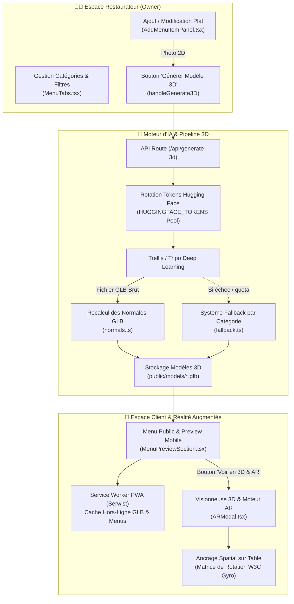

# 🍽️ Restivo — Module Menu Interactif, Génération 3D par IA & Réalité Augmentée (WebAR)

<div align="center">


<p align="center">
  <b>Dossier Technique & Documentation de la contribution d'Oussama Negzaoui : Digitalisation immersive du menu de restauration avec reconstruction 3D par Deep Learning, Réalité Augmentée Web (WebAR) ancrée sur table à taille réelle 1:1, et résilience PWA hors-ligne.</b>
</p>

</div>

---

## 🎯 Périmètre du Module (Contribution d'Oussama Negzaoui)

Dans le cadre du projet **Restivo**, ce module constitue le cœur de l'expérience visuelle et interactive entre le restaurateur et le client :

1. **Espace Restaurateur (Owner)** : Gestion dynamique du menu (catégories, plats, badges nutritionnels, prix, dimensions en cm) et conversion automatique d'une photo 2D en modèle 3D par Intelligence Artificielle.
2. **Moteur d'IA & Pipeline 3D** : Intégration de modèles génératifs (Trellis / Tripo), rotation automatique d'un pool de tokens Hugging Face, système de fallback instantané et post-traitement des normales GLB pour un rendu photoréaliste.
3. **Expérience Client WebAR (Sur Table)** : Visualisation 3D 360° et projection en Réalité Augmentée directement dans le navigateur du smartphone (sans application native), avec ancrage spatial W3C sur la table réelle, physique de caméra avancée et taille officielle 1:1 en centimètres.
4. **PWA, Mode Hors-Ligne & Performance Mobile** : Support offline complet (mise en cache des modèles 3D et du menu via Service Worker Serwist) et gestuelle mobile native (Pull-to-Refresh fluide sans scintillement GPU).

---

## 🏗️ Architecture Technique du Module



---

## 🚀 Fonctionnalités Détaillées Développées

### 1. 🍳 Gestion du Menu & Expérience Restaurateur
* **Formulaire Latéral d'Ajout / Modification (`AddMenuItemPanel.tsx`)** :
  * Upload de photo en direct avec recadrage et aperçu instantané.
  * Sélection ou détection automatique de la **Taille Réelle 1:1 en cm** (`Burger : 12 cm`, `Pizza : 30 cm`, `M9loub : 22 cm`, `Boisson : 8 cm`, etc.).
  * Gestion des régimes alimentaires et allergènes : *Halal*, *Végétarien*, *Vegan*, *Sans Gluten*, *Épicé*.
  * Toggle de disponibilité immédiat en stock.
* **Tableau de Bord & Navigation par Catégories (`MenuTable.tsx`, `MenuTabs.tsx`)** :
  * Organisation fluide par catégories avec filtres dynamiques et recherche instantanée.
  * Nettoyage automatique des balises internes (`META`, `TAGS`) pour garantir un affichage propre côté client.

---

### 2. 🧠 Pipeline d'Intelligence Artificielle & Modélisation 3D
* **Reconstruction 3D Neuronale (`/api/generate-3d/route.ts`)** :
  * Envoi de l'image du plat au modèle **Trellis / Tripo** pour extraire la géométrie et les textures PBR en quelques secondes.
* **Pool de Tokens Hugging Face avec Rotation Automatique (`trellis.ts`)** :
  * Rotation intelligente entre plusieurs clés d'API configurées dans `.env` (`HUGGINGFACE_TOKENS`) pour éviter les blocages de quota ou les limitations de débit lors des générations répétées.
* **Recalcul Binaire des Normales GLB (`normals.ts`)** :
  * Traitement du buffer binaire GLB pour recalculer les normales de surface.
  * Élimine les faces sombres ou mal orientées et assure un rendu photoréaliste sous la lumière ambiante.
* **Système de Repli Instantané (Fallback)** :
  * Si l'API d'IA externe est saturée, le système sélectionne automatiquement un modèle 3D optimisé correspondant à la catégorie du plat pour que le restaurateur ne soit jamais bloqué.

---

### 3. 📱 Réalité Augmentée WebAR sur Table (`ARModal.tsx`)
Le joyau technologique du module : une expérience de réalité augmentée exécutable **directement dans le navigateur mobile**, sans requérir Google Play Services for AR ou ARKit :

* **Mode Visionneuse 3D 360°** :
  * Intégration de `<model-viewer>` avec rotation orbitale fluide, zoom tactile (pinch-to-zoom) et ombre de contact réaliste sur le sol.
* **Ancrage Spatial 3D sur la Table (`Fixé sur table`)** :
  * Calibrage à la volée de l'orientation spatiale de l'appareil (W3C `DeviceOrientationEvent` : alpha, beta, gamma).
  * Projection via matrice de rotation 3D pour verrouiller les coordonnées du plat (`X, Y`) exactement sur le tapis ou la table du client pendant ses mouvements de caméra.
* **Physique de Caméra & Sortie Naturelle du Cadre** :
  * **Pitch Up Exit** : Dès que l'utilisateur lève son téléphone pour regarder la pièce ou son écran (`beta > anchor.beta0 + 7°`), le plat descend naturellement et quitte le champ de vision par le bas de la caméra.
  * **Yaw Exit** : Si l'utilisateur tourne le téléphone sur le côté à plus de `24°`, le plat sort élégamment de l'écran. Dès que la caméra est repointer vers la table, le plat réapparaît exactement à son emplacement d'origine.
* **Inspection Multi-Angle** :
  * **Vue du Dessus (`Vue Dessus`)** : Incliner le téléphone au-dessus du plat abaisse automatiquement l'angle polaire `phi` jusqu'à `14°` pour voir l'intérieur de la garniture.
  * **Vue Latérale / Rotation** : Incliner le téléphone à gauche ou à droite déclenche une rotation azimutale `theta` autour du plat, avec compensation du roulis (`gamma`) pour empêcher les faux déclenchements de la vue de dessus.
* **Taille Officielle 1:1 en Centimètres** :
  * Calibrage optique selon la distance standard de la table (~40 cm). Le burger mesure réellement 12 cm, la pizza 30 cm, etc.

---

### 4. ⚡ PWA, Résilience Hors-Ligne & Gestuelle Mobile
* **Architecture PWA (Progressive Web App)** :
  * Service Worker propulsé par **Serwist** (`sw.ts`).
  * Mise en cache locale persistante des menus, des images et des fichiers 3D volumineux (`.glb`).
  * Les clients et le personnel peuvent rouvrir le menu et inspecter les plats même en cas de coupure de réseau.
* **Pull-to-Refresh Natif Mobile (`PullToRefresh.tsx`)** :
  * Expérience de rafraîchissement tactile fluide calquée sur Instagram et Facebook.
  * Détection intelligente du scroll parent (zone morte de 16 px) pour éviter tout déclenchement accidentel au milieu d'une liste de plats.
  * Élimination totale des flashs blancs GPU sur Chrome Android.

---

## 📂 Cartographie des Fichiers Développés

| Fichier Clé | Emplacement | Rôle dans le Module |
| :--- | :--- | :--- |
| **`ARModal.tsx`** | [`app/mainpage/restaurants/menu/_components/ARModal.tsx`](file:///c:/Users/Negza/Desktop/Project%20Next/restivo-V1-main/app/mainpage/restaurants/menu/_components/ARModal.tsx) | **Cœur WebAR** : Caméra HD, ancrage spatial 3D, matrice de rotation, physique de sortie du cadre, scaling 1:1 en cm. |
| **`tags.ts`** | [`lib/menu/tags.ts`](file:///c:/Users/Negza/Desktop/Project%20Next/restivo-V1-main/lib/menu/tags.ts) | Presets de dimensions réelles en cm, calcul de l'échelle AR et parsing des métadonnées nutritionnelles. |
| **`AddMenuItemPanel.tsx`** | [`app/mainpage/restaurants/menu/_components/AddMenuItemPanel.tsx`](file:///c:/Users/Negza/Desktop/Project%20Next/restivo-V1-main/app/mainpage/restaurants/menu/_components/AddMenuItemPanel.tsx) | Drawer d'ajout/édition de plat avec déclencheur de génération 3D et sélection de taille. |
| **`MenuPreviewSection.tsx`** | [`app/mainpage/restaurants/menu/_components/MenuPreviewSection.tsx`](file:///c:/Users/Negza/Desktop/Project%20Next/restivo-V1-main/app/mainpage/restaurants/menu/_components/MenuPreviewSection.tsx) | Cartes de plats du menu client, badges de dimension (`📏 12 cm`) et déclencheur du modal AR. |
| **`MenuPreview.tsx`** | [`app/mainpage/restaurants/menu/_components/MenuPreview.tsx`](file:///c:/Users/Negza/Desktop/Project%20Next/restivo-V1-main/app/mainpage/restaurants/menu/_components/MenuPreview.tsx) | Vue miroir responsive du menu mobile optimisée pour les performances GPU. |
| **`route.ts` (API 3D)** | [`app/api/generate-3d/route.ts`](file:///c:/Users/Negza/Desktop/Project%20Next/restivo-V1-main/app/api/generate-3d/route.ts) | Pipeline de génération 3D, réception d'image, liaison IA et sauvegarde des fichiers GLB. |
| **`trellis.ts`** | [`app/api/generate-3d/trellis.ts`](file:///c:/Users/Negza/Desktop/Project%20Next/restivo-V1-main/app/api/generate-3d/trellis.ts) | Connecteur Trellis AI avec algorithme de rotation de tokens Hugging Face. |
| **`normals.ts`** | [`app/api/generate-3d/normals.ts`](file:///c:/Users/Negza/Desktop/Project%20Next/restivo-V1-main/app/api/generate-3d/normals.ts) | Recalcul binaire des vecteurs normaux pour des ombrages 3D parfaits. |
| **`fallback.ts`** | [`app/api/generate-3d/fallback.ts`](file:///c:/Users/Negza/Desktop/Project%20Next/restivo-V1-main/app/api/generate-3d/fallback.ts) | Modèles 3D de secours par catégorie en cas de surcharge d'API. |
| **`PullToRefresh.tsx`** | [`app/_components/PullToRefresh.tsx`](file:///c:/Users/Negza/Desktop/Project%20Next/restivo-V1-main/app/_components/PullToRefresh.tsx) | Composant tactile de rafraîchissement natif pour mobile. |

---

## 🛠️ Instructions de Lancement & Test sur Smartphone

Pour tester la Réalité Augmentée et la caméra sur un vrai smartphone, un contexte sécurisé **HTTPS** est obligatoire :

### 1. Démarrer le serveur de développement
```bash
npm run dev
```

### 2. Ouvrir le tunnel Cloudflare (Accès Téléphone)
Dans un second terminal :
```bash
npm run tunnel
# ou
cloudflared tunnel --url http://localhost:3000
```

Copiez l'URL HTTPS générée (ex: `https://xxxx.trycloudflare.com`) et ouvrez-la sur votre smartphone.

### 3. Procédure de Test AR (Scénario de Démonstration)
1. Rendez-vous sur le **Menu** d'un restaurant.
2. Choisissez un plat (ex: *Cheeseburger Gourmet* ou *Pizza 4 Saisons*) et appuyez sur **"📱 Voir en 3D & Réalité Augmentée"**.
3. Appuyez sur **"📸 Poser sur ma table"** et autorisez la caméra et les capteurs d'orientation.
4. Positionnez le plat sur la table réelle et appuyez sur **"📍 Fixer sur table"**.
5. **Vérifications de la physique d'ancrage** :
   * Inclinez le téléphone au-dessus : le burger passe automatiquement en **Vue Dessus**.
   * Tournez légèrement autour : observez les côtés en 3D sans dérive de position.
   * Levez le téléphone vers le haut : le plat descend et quitte l'écran de manière fluide.
   * Baissez à nouveau le téléphone vers la table : le plat réapparaît exactement à son point d'ancrage !

---

## 👨‍💻 Auteur

* **Oussama Negzaoui** — Responsable du Module Menu, Génération 3D & Réalité Augmentée (WebAR).
* Branche Git : `Negzaoui`

---

<div align="center">
  <sub>Projet Restivo — Module Menu & Expérience 3D/AR développé avec rigueur et passion.</sub>
</div>
